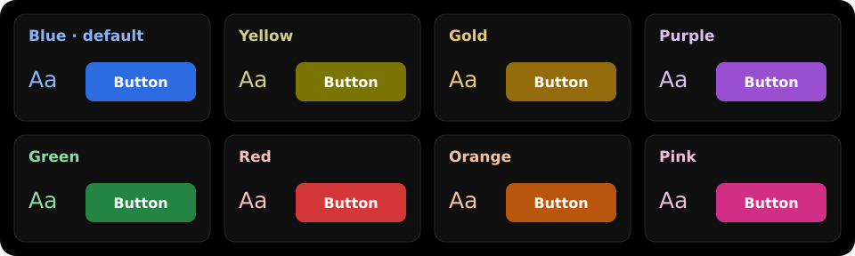
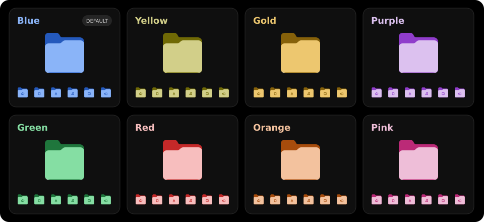

<p align="center">
  
</p>
<h1 align="center">Adwaita AMOLED</h1>
<p align="center">
  <strong>True black. Eight accents. Classic Adwaita.</strong><br>
  A coordinated AMOLED theme for your desktop and favorite applications.
</p>
<p align="center">
  <a href="https://github.com/librerob/adwaita-amoled/releases/latest"></a>
  <a href="#installation"></a>
  <a href="ACCENT_COLORS.md"></a>
</p>
<p align="center">
  <a href="COMPATIBILITY.md"></a>
  <a href="INSTALLING.md#gtk4-and-libadwaita-overrides"></a>
  <a href="gnome-shell/README.md"></a>
  <a href="INSTALLING.md#every-extra-and-destination"></a>
  <a href="INSTALLING.md#folder-icon-theme"></a>
</p>
<p align="center">
  <a href="INSTALLING.md#every-extra-and-destination"></a>
  <a href="INSTALLING.md#every-extra-and-destination"></a>
  <a href="INSTALLING.md#every-extra-and-destination"></a>
  <a href="INSTALLING.md#every-extra-and-destination"></a>
  <a href="extra/wallpaper/blackmount.png"></a>
</p>
<p align="center">
  <a href="#features">Features</a> ·
  <a href="#installation">Installation</a> ·
  <a href="#compatibility">Compatibility</a> ·
  <a href="#documentation">Documentation</a>
</p>

---

<p align="center">
  <a href="extra/screenshot/screenshot2.png"></a><br>
  <sub>Black surfaces, subtle layers and familiar controls. Click to view full size.</sub>
</p>

<details>
<summary>More screenshots — desktop and terminal</summary>


These screenshots show the theme's appearance; application icons and panel layout depend on your setup.

</details>

## Features

- True-black backgrounds (`#000000`) with subtle raised surfaces
- Eight accents: **blue** (default), yellow, gold, purple, green, red, orange and pink
- GTK2, GTK3 and GTK4 styling, plus optional libadwaita user CSS overrides
- Cinnamon and Xfce styling, Openbox themes, and Metacity/Muffin/Marco window decorations
- Matching GNOME Shell themes for **46.x and 51.x**
- Coordinated Qt5ct/Qt6ct palettes
- Matching Kitty, Alacritty, Neovim/Airline, bat, Rofi and Zsh themes, plus wallpaper
- Optional [accent-colored Adwaita folder icons](INSTALLING.md#folder-icon-theme)

Accents use light text/focus colors and darker filled buttons with white labels.
All eight Shell presets match the selected theme accent independently of GNOME
Settings. See [accent choices and measured contrast](ACCENT_COLORS.md).

<p align="center">
  <a href="ACCENT_COLORS.md"></a><br>
  <sub>One black foundation. Light accents for text and focus; deeper fills with white labels.</sub>
</p>

<p align="center">
  <a href="extra/readme/folder-presets.svg"></a><br>
  <sub>Matching Adwaita folders, optional in setup. Click to view full size.</sub>
</p>


## Installation

Download the **Adwaita-AMOLED `.tar.gz` archive** from the
[latest release](https://github.com/librerob/adwaita-amoled/releases/latest),
extract it, and open a terminal inside the **Adwaita-AMOLED** folder:

```bash
./install.sh
```

Run user setup **without sudo**. The installer uses Bash; no Python, compiler
or additional menu package is required.

Choose **Accent color** if you want a different preset, then **Install/update
for this user**. Guided setup offers GTK4/libadwaita styling, desktop selection,
matching supported GNOME Shell styling, optional app themes and folder icons. Review the
changes, then choose **Apply**, **Cancel** or **Preview**.

Selecting GTK4/libadwaita setup replaces existing CSS/assets overrides **without
backups**; guided setup defaults to keeping existing overrides. App extras
still need selection or inclusion in each application.

To update, extract a newer release into a fresh folder and rerun setup. Updates
replace installed theme files and retain your accent choice. Select optional
extras again to update their copied files. Restart affected apps afterward.

Supported app appearance preferences are set to dark automatically. If Firefox
stays light, select **System theme — auto**; see
[Firefox setup](INSTALLING.md#firefox-dark-appearance).

See the [installation guide](INSTALLING.md) for command-line options, exact
paths, Flatpak, system-wide setup, removal and manual configuration. See
[accent choices and measured contrast](ACCENT_COLORS.md) for the palette details.

### Manual installation

<details>
<summary>Show manual copy instructions (default blue)</summary>

The manual instructions install the default blue theme. Use the installer to
select a different accent consistently across compiled resources and app extras.

From the extracted theme/repository directory, copy the compiled theme folders:

```bash
amoled_theme="${XDG_DATA_HOME:-$HOME/.local/share}/themes/Adwaita-AMOLED"
mkdir -p "$amoled_theme"
cp -R cinnamon gnome-shell gtk-2.0 gtk-3.0 gtk-4.0 metacity-1 openbox-3 extra "$amoled_theme/"
cp index.theme LICENSE accent-name "$amoled_theme/"
mkdir -p "$HOME/.themes"
if [ ! -e "$HOME/.themes/Adwaita-AMOLED" ] && [ ! -L "$HOME/.themes/Adwaita-AMOLED" ]; then
  ln -s "$amoled_theme" "$HOME/.themes/Adwaita-AMOLED"
fi
```

Select it in Appearance settings. See [manual GTK4 overrides](INSTALLING.md#gtk4-and-libadwaita-overrides)
and [manual extras](INSTALLING.md#manual-extras) for application configuration.
GTK2 apps require the Murrine engine. No Xfwm4 decoration theme is included.

For GNOME Shell, also follow the [version-specific installation instructions](gnome-shell/README.md#install-and-activate).

</details>

## Application extras

Choose extras in setup for **Qt5ct/Qt6ct, Kitty, Alacritty, Neovim/Airline, bat,
Rofi, Zsh, wallpaper and folder icons**. Then select or include the theme files in each
application. Optional applications and plugins are not installed automatically.

See [app setup and file destinations](INSTALLING.md#every-extra-and-destination).

## Compatibility

- **GTK2:** requires your distribution's Murrine engine.
- **GNOME Shell:** verified for **46.x and 51.x**, with the
  [User Themes extension](https://extensions.gnome.org/extension/19/user-themes/).
  Other Shell major versions are unverified; GDM/login screens are not themed.
- **Qt:** requires qt5ct/qt6ct and the appropriate integration plugin.
- **Window decorations:** Openbox and Metacity/Muffin/Marco are included;
  Xfwm4 decorations are not included.

Applications and extensions may apply their own styling. See the
[compatibility review](COMPATIBILITY.md) and [Shell guide](gnome-shell/README.md)
for tested versions and coverage limits.

## Documentation

- [Installation, updates, removal and manual configuration](INSTALLING.md)
- [Accent choices and contrast](ACCENT_COLORS.md)
- [Development, building and testing](https://github.com/librerob/adwaita-amoled/blob/main/CONTRIBUTING.md)
- Detailed color reviews: [readability](COLOR_READABILITY.md) and
  [compound states and file coverage](COLOR_COMPLETENESS.md)

## Feedback

[Report a problem or contribute](https://github.com/librerob/adwaita-amoled/issues).
Include your distribution, desktop/version, application, selected accent and
theme version so the problem can be reproduced.
