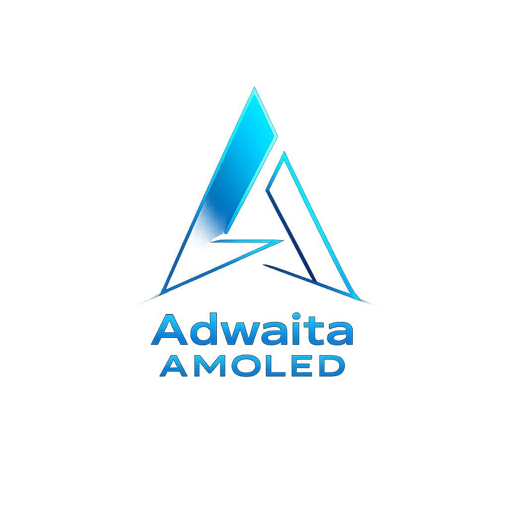
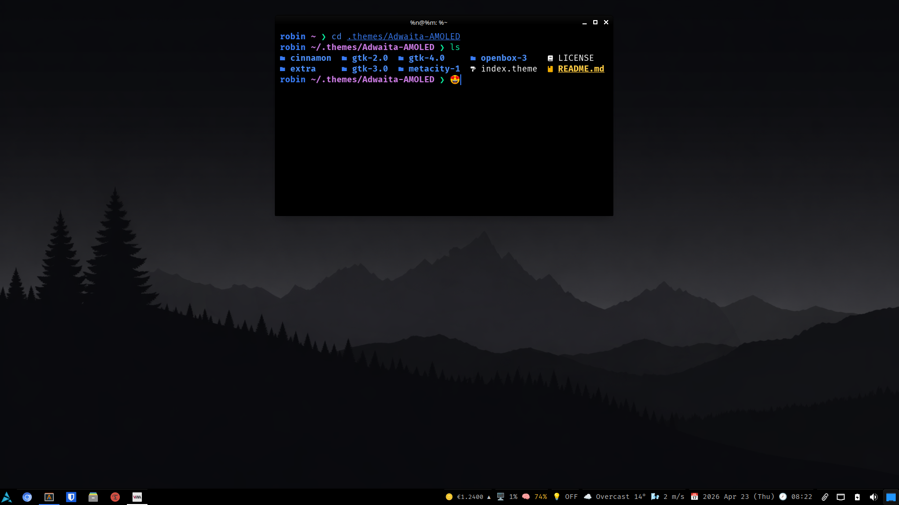
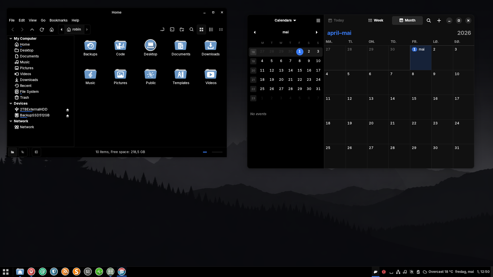

<p align="center">
  
</p>
<h1 align="center">Adwaita AMOLED</h1>
<p align="center">
A true black, AMOLED-optimized take on the classic Adwaita design.
</p>
<p align="center">


</p>

---

<p align="center">
  
</p>

<p align="center">
  
</p>


---

## Features

- True AMOLED base (`#000000`) with layered depth
- Clear visual hierarchy across all widget states, unfocused, hover, active
- Correct GTK3 widget rendering: checkboxes show ✓, radio buttons show ●, indeterminate states work
- Refined XFCE panel with accent underline focus indicator, no flat white blocks
- Complete GTK2 theme via the murrine engine, fully styled across all widget classes
- GTK4 + libadwaita color overrides included
- GNOME Shell 46 and 51 themes based on their matching upstream defaults, with an AMOLED palette
- Cinnamon shell theme, Openbox theme, and Metacity window decorations included
- Qt5ct and Qt6ct color schemes aligned with the GTK palette

See [tested upstream versions and coverage limits](COMPATIBILITY.md) for the
latest compatibility review. See the [color readability audit](COLOR_READABILITY.md)
for color roles, native measurements and the limits of contrast checks. The
[repository-wide color follow-up](COLOR_COMPLETENESS.md) records compound-state
fixes and the expanded file/paint review.

---

## Installation

The compiled theme is included. The installer is plain **Bash**: no Python,
compiler, downloads or saved installer state.

```bash
git clone https://github.com/librerob/adwaita-amoled.git
cd adwaita-amoled
./install.sh
```

This copies the theme into `~/.local/share/themes/Adwaita-AMOLED`. Select it in
Appearance settings, or also apply native GTK4/libadwaita and desktop selection:

```bash
./install.sh -l --activate
```

Run user setup without sudo. `-l` replaces the GTK4 CSS/assets overrides with
symlinks to the theme; **no backups are made**. Rerun from a newer download with
the same options to update. Old installer state and locally changed installed
files do not block copying. Restart affected apps afterward.

```bash
./install.sh --extras qt,kitty,nvim  # Copy optional app theme files
./install.sh --dry-run             # Preview file operations
sudo ./install.sh --system         # Shared theme, without user configuration
./install.sh --remove -l           # Remove theme and its native GTK4 links
```

Extras create missing folders but leave existing app settings alone; select or
include their theme files in each app. XDG directory overrides are honored.
[The installation guide](INSTALLING.md) explains every destination, optional
per-app Flatpak setup, GNOME Shell selection and manual configuration.

### Manual installation

From the extracted theme/repository directory, copy the compiled theme folders:

```bash
amoled_theme="${XDG_DATA_HOME:-$HOME/.local/share}/themes/Adwaita-AMOLED"
mkdir -p "$amoled_theme"
cp -R cinnamon gnome-shell gtk-2.0 gtk-3.0 gtk-4.0 metacity-1 openbox-3 extra "$amoled_theme/"
cp index.theme LICENSE "$amoled_theme/"
```

Select it in Appearance settings. See [manual GTK4 overrides](INSTALLING.md#gtk4-and-libadwaita-overrides)
and [manual extras](INSTALLING.md#manual-extras) for application configuration.
GTK2 apps require the Murrine engine. No Xfwm4 decoration theme is included.

## GNOME Shell

The included Shell themes target **GNOME Shell 46.x and 51.x**, based on upstream
**46.10 and 51.1** respectively. The installer detects the local Shell version
and installs the matching stylesheet; other major versions are unverified.
Install the [User Themes extension](https://extensions.gnome.org/extension/19/user-themes/)
and log in again if needed, then run `./install.sh --shell --activate`, or select Adwaita-AMOLED in the
extension's settings.
[Shell details](gnome-shell/README.md) explain its scope and rebuilding. The
logged-in Shell is themed; other Shell major versions and GDM are outside its
verified scope.

For manual installation on GNOME 46, copy `gnome-shell-46.css` over
`gnome-shell.css` **inside the installed theme's `gnome-shell/` directory**, keeping
the complete `assets/` directory beside it. The source archive's default entry
is GNOME 51; it must not be selected unchanged on GNOME 46. Toggle User Themes
off/on, or log out and back in, after changing the installed stylesheet.

## Extras

Copy these optional theme files with `--extras LIST`, then select them in each app:

| Component | Effect |
|---|---|
| `qt` | Install Qt5ct/Qt6ct palettes and optional scrollbar QSS; select through Qt settings |
| `kitty` | Copy terminal colors, cursor and tab settings for inclusion in Kitty |
| `alacritty` | Copy the TOML theme for import from your existing configuration |
| `bat` | Copy the syntax theme and rebuild bat's cache when installed |
| `nvim` | Copy the Neovim and optional Airline themes for selection |
| `rofi` | Copy the launcher theme for selection/import |
| `zsh` | Copy prompt/completion/plugin colors for sourcing from your existing .zshrc |
| `wallpaper` | Copy the wallpaper for selection in background settings |

[INSTALLING.md](INSTALLING.md#every-extra-and-destination) explains the exact
paths and effects. Optional applications/plugins are not installed automatically.

---

## Building and testing

Developers editing GTK source need GLib's resource compiler. Ordinary
installation does not require a build:

```bash
# Debian / Ubuntu
sudo apt install libglib2.0-dev
# Arch / Artix
sudo pacman -S glib2
```

```bash
./build.sh
./build.sh --install
```

`--install` builds the GTK bundles, then runs the Bash installer. Additional
installer options can follow `--install`, for example `./build.sh --install -l`.
No Python is required to build GTK resources or install the theme.
After editing `src/`, rebuild and commit the updated `gtk.gresource` bundles
together with their source changes.

The GNOME Shell CSS is also included precompiled. After changing its Sass
palette, rebuild it separately with `./gnome-shell/build.sh` (requires `sassc`).

Build an installer-enabled runtime archive (without source GTK files or tests):

```bash
python3 tools/package.py /tmp/Adwaita-AMOLED-installer-preview.tar.gz
```

The archive includes per-file checksums; a separate SHA-256 file is written beside
it. This creates local files and does not publish a GitHub release.

The repository's regression checks and their prerequisites are documented in
[tests/README.md](tests/README.md). GitHub Actions runs them on pull requests.

---

## Wallpaper

A matching wallpaper is included at `extra/wallpaper/blackmount.png`.

---

## Color Palette

| Token | Hex | Role |
|---|---|---|
| Background | `#000000` | Window base, AMOLED black |
| Surface 1 | `#0f0f0f` | Cards, lists |
| Surface 2 | `#141414` | Popovers, tooltips |
| Hover | `#1a1a1a` | Hover state |
| Control border | `#808080` | Identifying control outlines |
| Decorative border | `#2a2a2a` | Nonessential separators and depth |
| Text accent | `#8ab4f8` | Readable accent text, links and focus |
| Filled GTK accent | `#2d6be0` | Selected surfaces with white text |
| Filled hover | `#2862cf` | Hovered selections/controls with white text |
| Foreground | `#ffffff` | Primary text |
| Dim | `#a0a0a0` | Readable secondary text |

Ordinary button/card outlines and header/sidebar separators use the subtle
decorative border. Text-field boundaries, checkbox/radio outlines and slider
handles retain identifying contrast; keyboard focus uses its separate accent
outline. Decorative lines are not all forced to the control-edge brightness.

White on the filled GTK accent has approximately 4.89:1 contrast. Extras that
use the pale `#8ab4f8` as a text background use black text (9.96:1).
Success surfaces use black text on `#26a269` (approximately 6.45:1).

### Why these colors

The palette separates standalone accent text from filled controls so that both
remain readable on AMOLED surfaces:

| Use | Foreground / background | Defined sRGB contrast |
|---|---|---|
| Accent text and links on black | `#8ab4f8` / `#000000` | 9.96:1 |
| Accent text on a raised surface | `#8ab4f8` / `#141414` | 8.74:1 |
| Filled blue controls | `#ffffff` / `#2d6be0` | 4.89:1 |
| Pale selections in applicable extras | `#000000` / `#8ab4f8` | 9.96:1 |

White text on the pale blue would reach only 2.11:1, so pale selections use black
labels. Dark blue buttons keep white labels. Focus/identifying graphics are
checked separately from text; disabled states and decorative separators have
different roles. GNOME Shell retains the system-selected accent hue and uses
state-specific filled colors.

These choices address measured contrast issues while retaining AMOLED black and
Adwaita's layout. They are not a claim that one blue is universally best, that
all users/displays see colors identically, or that contrast ratios alone prove
complete accessibility. The [readability audit](COLOR_READABILITY.md) and
[broader color follow-up](COLOR_COMPLETENESS.md) document native state tests,
intentional exceptions and remaining limits.

---

## Structure

```
Adwaita-AMOLED/
├── cinnamon/               Cinnamon shell theme
├── gnome-shell/            GNOME Shell 46/51 themes, assets and Sass source
├── gtk-2.0/                GTK2 theme (murrine engine)
├── gtk-3.0/                GTK3 theme
├── gtk-4.0/                GTK4 theme
├── metacity-1/             Metacity / Muffin window decorations
├── openbox-3/              Openbox window manager theme
├── extra/
│   ├── alacritty/          Alacritty terminal theme
│   ├── kitty/              Kitty terminal theme
│   ├── libadwaita/         Native GTK4 entry points, linked with install.sh -l
│   ├── logo/               Theme logo
│   ├── nvim/               Neovim colorscheme and airline theme
│   ├── qt5ct/              Qt5 color scheme
│   ├── qt6ct/              Qt6 color scheme
│   ├── rofi/               Rofi launcher theme
│   ├── screenshot/         Preview image
│   ├── wallpaper/          Matching wallpaper
│   └── zsh/                Zsh autosuggestions & syntax highlighting config
├── install.sh              Direct Bash installer
├── tools/                  Development archive builder
├── INSTALLING.md           Installation and manual configuration guide
└── index.theme
```

---

## Philosophy

Minimal, readable, and actually usable.
No washed-out grays, no invisible states.
